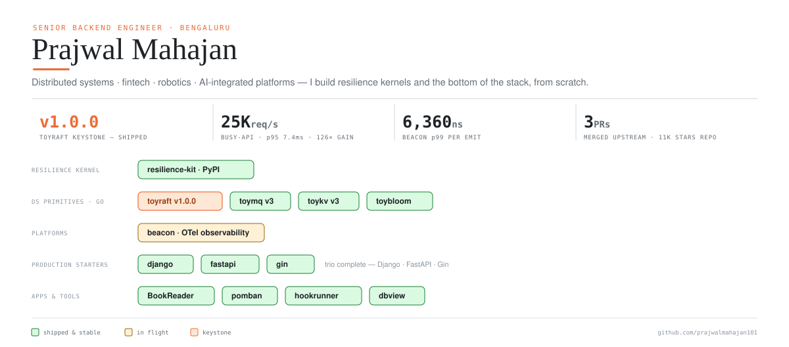
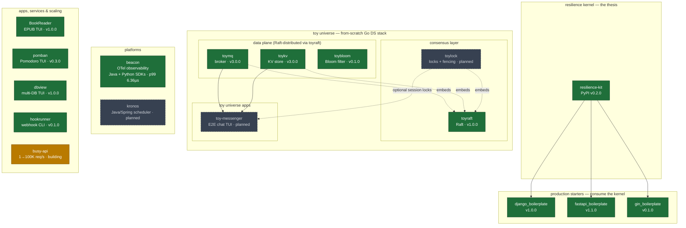

<picture>
  <source media="(prefers-color-scheme: dark)" srcset="assets/hero-dark.svg">
  
</picture>

  &nbsp;
  &nbsp;
  &nbsp;
  

### Hi, I'm Prajwal 👋

> **Senior backend engineer** (Bengaluru) — I build **resilience kernels**, push correctness invariants into **Postgres**, and ship **LLM-powered services** in production. On the side, I rebuild the bottom of the distributed-systems stack (broker · KV · consensus) from scratch in Go until it dogfoods itself.

**Currently** — Lead architect at [Optimo Capitals](https://optimocapital.in/): the OptiView dashboard platform, a 5-service co-lending mesh (sole author of 4 of 5 repos), three AWS Lambda services, and the AA-consent pipeline. After the resilience-kernel rollout, platform latency and DB load came down hard and uptime moved from "good enough" to boring — that kernel is open-sourced as [`resilience-kit`](https://github.com/prajwalmahajan101/resilience-kit).

**Previously** — Backend lead at Viamagus on **Quason** (VDA 5050 fleet backbone — 100+ AMRs at ~10k msgs/sec, zero observed message loss in production) and **Synthia** (RAG legal assistant with a Word-plugin agent on GPT-4).

---

#### 🧩 What I build

- **Resilience kernels** — circuit breakers, retries with backoff + jitter, idempotency, tiered rate limiting, DLQs
- **Postgres-enforced invariants** — CHECK constraints, BEFORE INSERT/UPDATE triggers, durable-id dedupe, declarative migrations
- **LLM platforms** — RAG pipelines, structured document extraction, Bedrock / Ollama / GPT-4 routing
- **Security at the lowest layer** — SSRF guards, HMAC + nonce webhooks, Fernet field crypto, fail-closed boot, audit logging

  
  
  
  
  
  
  
  
  

---

#### 🚀 Flagship work

- 🗝️ **[`toyraft`](https://github.com/prajwalmahajan101/toyraft) `v1.0.0`** — Raft consensus from the paper, in Go. Spec-first, deterministic test infra, a **1000-seed at-most-one-leader-per-term invariant**, Porcupine linearizability. GA'd only after two real consumers dogfooded the rc — the keystone the stack is built on.
- 📨 **[`toymq`](https://github.com/prajwalmahajan101/toymq) `v3.0.0` · [`toykv`](https://github.com/prajwalmahajan101/toykv) `v3.0.0`** — a persistent broker and a persistent KV store, both now **Raft-distributed**: they embed `toyraft`, do quorum reads/writes across a 3-node cluster, and pass Porcupine linearizability on partition-heal.
- 🛡️ **[`resilience-kit`](https://github.com/prajwalmahajan101/resilience-kit) `v0.2.0`** (on PyPI) — a framework-agnostic Python resilience + core-infra kernel extracted from production. Retries, breakers, throttles, SSRF-guarded HTTP, audit decorators, field crypto; Django + FastAPI adapters. — [write-up](https://dev.to/prajwalmahajan101/building-resilience-kit-a-python-resilience-kernel-forged-in-production-5973)
- 🔭 **[`beacon`](https://github.com/prajwalmahajan101/beacon)** — a self-hosted OpenTelemetry-native observability platform. Java + Python SDKs with byte-parity conformance, a production Logback appender + Spring Boot auto-config, and a **JMH benchmark of p99 = 6,360 ns per emit**.

<strong>📦 Full portfolio</strong> — every public repo, grouped

 

**Libraries** *(the thesis — everything else consumes these)*
- [`resilience-kit`](https://github.com/prajwalmahajan101/resilience-kit) — framework-agnostic Python resilience + core-infra kernel · pluggable backends, Django + FastAPI adapters · [`v0.2.0`](https://github.com/prajwalmahajan101/resilience-kit/releases/tag/v0.2.0) on PyPI adds Prometheus/OTel/Sentry sinks, a PII redactor, and MultiFernet key rotation

**Distributed-systems track** *(the bottom of the stack, from scratch in Go — consensus · broker · KV · Bloom filter)*
- [`toyraft`](https://github.com/prajwalmahajan101/toyraft) — Raft from the paper · all 14 phases closed (election, replication, fsynced storage + torn-tail recovery, HTTP transport, seeded chaos, Porcupine linearizability, netns chaos, observability/GoReleaser) · [`v1.0.0`](https://github.com/prajwalmahajan101/toyraft/releases/tag/v1.0.0) **FINAL**
- [`toymq`](https://github.com/prajwalmahajan101/toymq) — persistent broker · append-only WAL + per-message fsync, at-least-once delivery, crash recovery · [`v3.0.0`](https://github.com/prajwalmahajan101/toymq/releases/tag/v3.0.0) Raft-distributed (quorum acks + `PUB…WAIT` barrier, `NOTLEADER` redirect) · [write-up](https://dev.to/prajwalmahajan101/building-toymq-a-from-scratch-persistent-message-broker-in-go-ob7)
- [`toykv`](https://github.com/prajwalmahajan101/toykv) — persistent KV · RESP3 codec, list/hash + AOF, TTL, AUTH+TLS, `toykv-cli`/`toykv-tui` · [`v3.0.0`](https://github.com/prajwalmahajan101/toykv/releases/tag/v3.0.0) Raft-distributed (quorum R/W, leader-redirecting `ClusterClient`) · [write-up](https://dev.to/prajwalmahajan101/building-toykv-a-from-scratch-persistent-kv-in-go-and-why-i-took-the-opposite-call-from-toymq-5862)
- [`toybloom`](https://github.com/prajwalmahajan101/toybloom) — from-scratch Bloom filter in Go · [`v0.1.0`](https://github.com/prajwalmahajan101/toybloom/releases/tag/v0.1.0) (M0–M10, v0.1 DoD met, CI green)

**Platforms**
- [`beacon`](https://github.com/prajwalmahajan101/beacon) — OTel-native logs/traces/metrics · Kafka buffer, polyglot storage, React console, Java + Python SDKs · spec-first: JSON Schema + conformance suite frozen at [`v0.1-m0`](https://github.com/prajwalmahajan101/beacon/releases/tag/v0.1-m0) **before any SDK code shipped** · M3 ingest tier (OTLP→Kafka→Vector→ES) built

**Production starters** *(consume `resilience-kit`)*
- [`gin_boilerplate`](https://github.com/prajwalmahajan101/gin_boilerplate) — production-shaped Go + Gin REST starter · [`v0.1.0`](https://github.com/prajwalmahajan101/gin_boilerplate) (2026-10-09) — closes the boilerplate trio (Django · FastAPI · Gin)
- [`fastapi_boilerplate`](https://github.com/prajwalmahajan101/fastapi_boilerplate) — FastAPI + async SQLAlchemy · [`v1.1.0`](https://github.com/prajwalmahajan101/fastapi_boilerplate/releases/tag/v1.1.0) · Redis-backed resilience, SSRF-safe HTTP, request-id audit log, Alembic, Docker
- [`django_boilerplate`](https://github.com/prajwalmahajan101/django_boilerplate) — Django 6 + DRF · [`v1.0.0`](https://github.com/prajwalmahajan101/django_boilerplate/releases/tag/v1.0.0) · typed exceptions, response envelopes, JWT + OAuth, Valkey throttles, AWS Secrets Manager overlay
- [`repay_sync`](https://github.com/prajwalmahajan101/repay_sync) — Django 5 + DRF loan-collection service · audit-logged mutations, agent-officer assignment, PTP/Refused/Partial dispositions, JWT, MPTT

**Apps & TUIs**
- [`BookReader`](https://github.com/prajwalmahajan101/BookReader) — terminal EPUB reader + personal library (Textual, SQLite) · inline kitty/iTerm2/WezTerm/sixel images, two-page mode, bookmarks + stats · [`v1.0.0`](https://github.com/prajwalmahajan101/BookReader/releases/tag/v1.0.0) · [docs](https://prajwalmahajan101.github.io/BookReader/) · `pipx install bookreader-tui`
- [`dbview`](https://github.com/prajwalmahajan101/dbview) — multi-DB terminal browser + query tool (Bubble Tea) · PostgreSQL + MySQL + SQLite behind one no-CGO static binary · [`v1.0.0`](https://github.com/prajwalmahajan101/dbview/releases/tag/v1.0.0) with GoReleaser binaries
- [`pomban`](https://github.com/prajwalmahajan101/pomban) — keyboard-driven Pomodoro TUI with kanban board + stats heatmap (Textual) · [`v0.3.0`](https://github.com/prajwalmahajan101/pomban/releases/tag/v0.3.0) on PyPI
- [`hookrunner`](https://github.com/prajwalmahajan101/hookrunner) — local HMAC-signed webhook receiver + replay · 4 signature schemes (Stripe/GitHub/HMAC/custom), SQLite capture, `serve`/`list`/`show`/`replay` CLI · [`v0.1.0`](https://github.com/prajwalmahajan101/hookrunner/releases/tag/v0.1.0)

**Developer tools**
- [`claude-skills-pack`](https://github.com/prajwalmahajan101/claude-skills-pack) — three independently installable [Claude Code](https://claude.com/claude-code) skills · **sb** (second-brain → Obsidian), **code_assist** (atomic commits + stack-aware reviews + phase journals), **unabridged** (untruncated output)

**Open source**
- [`yorukot/superfile`](https://github.com/yorukot/superfile) (~11k★ Go TUI file manager) — **3 PRs merged upstream** (first external OSS PRs since 2022): [#1509](https://github.com/yorukot/superfile/pull/1509), [#1518](https://github.com/yorukot/superfile/pull/1518), [#1519](https://github.com/yorukot/superfile/pull/1519)

<strong>Personal tooling</strong> — daily-driver dotfiles & editor config (not maintained as products)

 

- [`omarchy-abyss-glass`](https://github.com/prajwalmahajan101/omarchy-abyss-glass) — Hyprland dotfiles · glass-morphic waybar, layered window animations, multi-monitor wallpaper engine
- [`nvim_config`](https://github.com/prajwalmahajan101/nvim_config) — LazyVim setup tuned for backend work · ~60ms cold start
- [`VaultTemplate`](https://github.com/prajwalmahajan101/VaultTemplate) — Obsidian vault template for bootstrapping a notes workspace

---

#### 🛠️ In flight & next

- **[`busy-api`](https://github.com/prajwalmahajan101/busy-api)** *(building now)* — a DB-backed Go/Gin read API scaled **1 → 100K req/s**, one bottleneck per rung, with a before/after k6 logbook (pgx/sqlc · Valkey · OTel). Rung 4 reached (cache-aside + pool tuning).
- **`kronos`** *(next)* — a multi-tenant distributed scheduler in **Java + Spring Boot**: per-tenant business calendars, at-least-once fire with no double-fire under scale, misfire/backfill, DLQ. Opens the public Java track.
- **`toylock`** — distributed lock service on `toyraft` (leases + fencing tokens + watches); the cheapest proof the Raft layer works in anger.
- **`toy-messenger`** — a TUI-only E2E-encrypted chat composing `toymq` + `toykv` into one user-facing artifact (3 of 4 deps now shipped).

<strong>🗺️ How it fits together</strong> — the full dependency graph

 

Green = shipped & stable · amber = in-flight · dashed grey = planned. Arrows point in the dependency direction — `toymq` / `toykv` / `toylock` each embed `toyraft` as an in-process library (same shape as etcd → etcd-raft). Raft serializes writes inside each store, so `toykv` does **not** consume `toylock`; `toylock` is a peer service that *applications* (like `toy-messenger`) call for cross-node leases or fencing.

---

#### ⚙️ How I work

Spec-first on anything load-bearing — PRD / HLD / LLD and ADRs before code. Deterministic test infra over flaky retries (fake clocks, seeded chaos transports, linearizability checkers). Release-purity: a thing ships when its stated DoD is met and a real consumer has used it, not when the calendar says so. Project state lives in briefs; READMEs, posts, and this profile derive from them, never the reverse.

> _Cadence: episodic — concentrated weekday-evening sessions, occasional full-day weekend pushes. The public surface ships in bursts; the day job is full-time. Silent stretches mean shipping elsewhere, not stalled._

---

#### ✍️ Writing & web

- Long-form at [dev.to/prajwalmahajan101](https://dev.to/prajwalmahajan101) and [prajwalmahajan101.hashnode.dev](https://prajwalmahajan101.hashnode.dev) — backend, distributed systems, AWS · source markdown in [`blog-posts`](https://github.com/prajwalmahajan101/blog-posts)
- [`portfolio`](https://github.com/prajwalmahajan101/portfolio) — personal site · [live](https://prajwalmahajan.in)

_Feed below is injected nightly from dev.to + Hashnode RSS; may go stale between writing bursts._

<!-- BLOG-POST-LIST:START -->
- 📝 **[Building toykv v2: seven features that didn&#39;t earn the major, one refusal that did](https://dev.to/prajwalmahajan101/building-toykv-v2-seven-features-that-didnt-earn-the-major-one-refusal-that-did-4jo8)** · Jul 22, 2026
- 📝 **[Building toymq v2: eight features, one durability contract, and the bug that proved it held](https://dev.to/prajwalmahajan101/building-toymq-v2-eight-features-one-durability-contract-and-the-bug-that-proved-it-held-19ff)** · Jul 13, 2026
- 📝 **[Building toykv: a from-scratch persistent KV in Go, and why I took the opposite call from toymq three times](https://dev.to/prajwalmahajan101/building-toykv-a-from-scratch-persistent-kv-in-go-and-why-i-took-the-opposite-call-from-toymq-5862)** · Jun 17, 2026
- 📝 **[Building resilience-kit: A Python Resilience Kernel Forged in Production](https://dev.to/prajwalmahajan101/building-resilience-kit-a-python-resilience-kernel-forged-in-production-5973)** · Jun 11, 2026

<!-- BLOG-POST-LIST:END -->

---

#### 📫 Reach me

  
  
  

